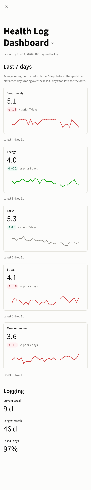
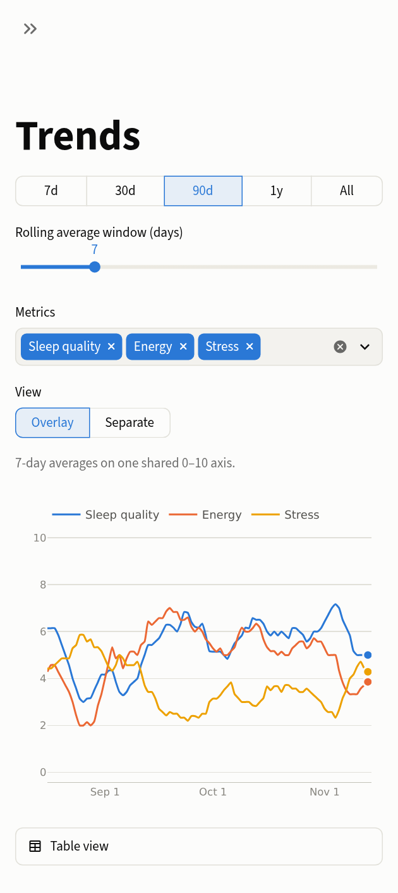
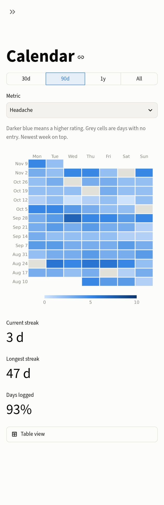
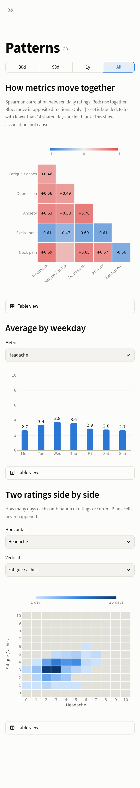

# Health Log Dashboard

[](https://github.com/jordan-finnell/health-log-dashboard/actions/workflows/ci.yml)

A private, self-hosted Streamlit dashboard for tracking, trending and visualizing a personal daily health log. A Google Form feeds a Google Sheet; the app reads that sheet (read-only) and turns it into trends, calendar heatmaps and pattern analysis, viewable from a browser on the home network.

> **Status:** working. The demo runs out of the box on synthetic data; live Google Sheets mode and the Docker deployment are in use by the author. See the roadmap below.

<table>
  <tr>
    <td></td>
    <td></td>
    <td></td>
    <td></td>
  </tr>
</table>

*Screenshots are taken in demo mode and show synthetic data only.*

The repo is public, but the author's data is not in it. With no credentials configured the app runs in **demo mode** on synthetic data, so everything here can be tried without access to any real log.

## What it shows
- **Overview:** latest values and 7-day averages compared with the previous 7 days, with a 30-day sparkline of the daily ratings (tap for the date)
- **Trends:** each metric over time with a rolling average whose window (1–30 days) you set with a slider
- **Calendar:** GitHub-style heatmap per metric, plus logging streaks
- **Patterns:** correlations between metrics, and a by-weekday view showing every day's rating with the average and middle half, so you see the spread and not just the mean
- **Data:** filterable table of the underlying log (live mode only; behind the password when one is set)

## Data model
One row per form submission, with a timestamp and a handful of daily 0–10 scores. The metrics are configuration, not code. The demo (and the screenshots above) use five generic wellbeing scores, three where higher is better and two where lower is better:

| Column | Meaning | Better when |
|---|---|---|
| `Timestamp` | When the form was submitted | n/a |
| `Sleep Quality` | How well you slept | higher |
| `Energy Level` | Energy through the day | higher |
| `Focus` | Ability to concentrate | higher |
| `Stress` | Felt stress | lower |
| `Muscle Soreness` | Aches after activity (added later in the demo log, so earlier days are blank) | lower |

The direction matters: the app colours a change as "good" or "bad" using each metric's own better-when flag, so a rising Stress score and a falling Sleep Quality score both read as worsening.

Real-world logs are messy, and the transform layer handles it: late-night logging (a submission before noon counts for the previous day), several submissions on one day, skipped days, mixed timestamp formats, and a metric that starts partway through the log. Missing values stay missing rather than being treated as zero.

## Design
- **Config-driven metrics:** column headers map to stable keys, labels, scales and a better-when direction in TOML (`config/demo.toml` for the demo, `config/metrics.example.toml` for a real sheet), so changing or renaming a survey question never touches the code.
- **Pluggable sources:** a `DataSource` interface with Google Sheets, CSV and synthetic implementations.
- **Logic separate from UI:** analytics live in a plain Python package with tests. Streamlit pages stay thin.
- **Mobile first:** layouts are designed for a phone screen. Charts disable drag-zoom so touch scrolling still works, and tapping shows a tooltip listing every series for that date.
- **Honest charts:** one axis and a fixed 0–10 scale; a metric keeps the same colour whatever is selected; missing days are blank, never zero; every chart has a table view; colours are validated for colour-blind separation in both light and dark themes.

## Privacy and security
- Access to the sheet uses a Google Cloud **service account** with the read-only Sheets scope, shared on that single sheet as Viewer. It can be revoked at any time by un-sharing.
- Credentials, the sheet ID and the app password live **outside the repository** in `~/.config/health-log-dashboard/secrets.toml` and are bind-mounted read-only into the container. They never enter the image or git history.
- Live mode has an **optional password gate**: set `app_password` and the dashboard asks for it before loading any data; leave it out and the dashboard opens directly, with a sidebar warning. The password only keeps other people on the same network out, so rely on the network boundary: the server is reachable only on the home LAN, with no port-forwarding and a firewall rule for the Private network profile only. If you ever expose it beyond the LAN, set a password.
- Real data is fetched into memory and cached briefly. Local data and key files are gitignored and dockerignored.
- Every commit is scanned for secrets with [gitleaks](https://github.com/gitleaks/gitleaks) via pre-commit, and again in CI.

## Quick start *(demo mode)*
Requires [uv](https://docs.astral.sh/uv/).

```bash
git clone https://github.com/jordan-finnell/health-log-dashboard.git && cd health-log-dashboard
uv sync
DEMO_MODE=1 uv run streamlit run app/Home.py
```
Then open <http://localhost:8501>. Every page works in demo mode with generated data; nothing connects to Google.

Dark and light themes follow your browser/OS setting.

## Self-hosting on Windows (WSL + Docker Desktop)
The author runs this on a Windows PC with the code in WSL2 and the app in Docker Desktop:

1. In Docker Desktop, enable Settings → Resources → WSL Integration for your distro, and "Start Docker Desktop when you sign in".
2. Create a Google Cloud service account, enable the Sheets API, and share your sheet with the service account as Viewer.
3. Save the key, sheet ID and (optionally) an app password in `~/.config/health-log-dashboard/secrets.toml` (`chmod 600`). See `.streamlit/secrets.toml.example`.
4. *(Optional)* If your sheet's headers differ from `config/metrics.example.toml`, copy it to `config/metrics.toml` (gitignored) and edit each metric's `column`, label, scale and `higher_is_better`. Then mount it by creating a gitignored `compose.override.yaml` next to `compose.yaml`:
   ```yaml
   services:
     dashboard:
       volumes:
         - ./config/metrics.toml:/app/config/metrics.toml:ro
   ```
   Demo mode ignores this file and always uses `config/demo.toml`.
5. From WSL: `docker compose up -d --build`. Re-run it after pulling code changes. `docker compose logs -f` shows the app's output. The container restarts automatically after a reboot once you are signed in to Windows.
6. In an admin PowerShell, allow the port on private networks only:
   `New-NetFirewallRule -DisplayName "Health Log Dashboard 8501" -Direction Inbound -Protocol TCP -LocalPort 8501 -Action Allow -Profile Private`
7. On your phone, open `http://<your PC's LAN IP>:8501`. Find the IP with `ipconfig` in Windows (not the address shown inside WSL), and give the PC a DHCP reservation so it stays stable.

The PC must be awake and signed in for the app to be reachable. The container runs as a non-root user with a read-only filesystem, and the secrets file is mounted read-only (compose refuses to start if it is missing). By default the port listens on all of the PC's network adapters; to pin it to one, set `BIND_ADDR=<ip>` in a gitignored `.env` file.

## Development
```bash
uv run pytest                        # tests, using synthetic data
uv run ruff check . && uv run ruff format .
uv run pre-commit run --all-files    # lint + secret scan
```

## Roadmap
- [x] Repo hygiene: gitignore, dockerignore, pre-commit with secret scanning
- [x] Data layer: sources, transform, analytics, synthetic generator, tests
- [x] Streamlit UI in demo mode (overview, trends, calendar, patterns, data)
- [x] Live Google Sheets mode with an optional password gate
- [x] Docker Compose deployment for LAN/phone access
- [x] CI (lint, tests, secret scan, image build) and demo screenshots
- [ ] Optional hosted demo

## License
MIT. See [LICENSE](LICENSE).
